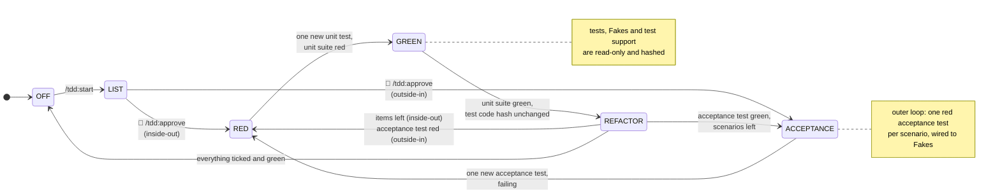

# TDD Guardian


[](https://docs.claude.com/en/docs/claude-code/plugins)
[](#github-copilot-cli-experimental)
[](https://claude.com/claude-code)
[](LICENSE)
[](https://nodejs.org)

A Claude Code plugin that **enforces** the Red-Green-Refactor cycle on the agent instead of merely
asking for it. A skill describes the process; hooks enforce it by blocking the writes the current
phase forbids. Every block explains the rule that was broken, why it exists, and what to do instead:
the plugin is a teaching aid as much as a guardian.

New to TDD? Read **[What is TDD, and what TDD Guardian enforces](docs/tdd.md)**: Red-Green-Refactor,
the three rules, Kent Beck's Canon TDD, and how each mistake it lists maps to a check of the plugin.

It targets what coding agents do when left alone with TDD:

- tautological tests, written together with the code they validate;
- tests edited, assertions weakened or `skip` added to get to green;
- several tests written at once, then all the code;
- refactoring skipped as soon as the suite is green;
- over-mocking, which couples tests to implementation details.

## Installation

```text
/plugin marketplace add ythirion/tdd-guardians
/plugin install tdd@tdd-guardians
```

For development, load the folder directly: `claude --plugin-dir /path/to/tdd-guardians`.

Requirements: Node.js 18 or later on the `PATH` (the hooks are plain Node scripts with no dependency,
so they run on macOS, Linux and Windows). The plugin's own test suite needs Node 21 or later.

### GitHub Copilot CLI (experimental)

The same plugin loads in [GitHub Copilot CLI](https://docs.github.com/copilot/concepts/agents/copilot-cli/about-cli-plugins),
which reads Claude Code plugins and their hooks:

```sh
copilot plugin marketplace add ythirion/tdd-guardians
copilot plugin install tdd@tdd-guardians
```

For development: `copilot --plugin-dir /path/to/tdd-guardians`.

What was adapted, from the hook payloads captured with Copilot CLI 1.0.105:

| Copilot behaviour | How TDD Guardian handles it |
| --- | --- |
| Every file creation and edit is its `Edit` tool with an `apply_patch` string (`*** Add File`, `*** Update File`, `*** Move to`, `*** Delete File`), possibly over several files | `guard-write` checks each file of the patch: phase matrix, one test at a time, mock policy |
| `args` next to `command` in `hooks.json` is ignored | each hook is a single command string, `node "${CLAUDE_PLUGIN_ROOT}/scripts/…"` |
| A `PreToolUse` hook that crashes denies the tool call (fail-closed) | hooks exit 0 on any input they do not understand |
| `Stop` ignores exit 2 | `check-stop` blocks with `{"decision":"block","reason":…}` on stdout |
| The agent's shell sets `COPILOT_CLI=1` | `tdd.js approve` and `off` refuse it, like `CLAUDECODE` |

Not verified yet under Copilot:

- whether `/tdd:approve` and `/tdd:off` typed in Copilot reach the `UserPromptSubmit` hook, or are
  taken as unknown slash commands. Until then, approve from your own terminal:
  `node <plugin>/scripts/tdd.js approve`;
- the `tdd-tester`, `tdd-implementer` and `tdd-refactorer` agents, written in the Claude Code format;
- a full Red-Green-Refactor session end to end.

A patch adding one test in each of two files passes the hook; `tdd.js next` still refuses it when
leaving RED.

## Usage

| Command | Who | Effect |
| --- | --- | --- |
| `/tdd:start <feature> [--mode inside-out\|outside-in]` | human or agent | Deduces the stack from the existing code (`package.json`, `pom.xml`, `build.gradle`, `pyproject.toml`, `*.csproj`); in an empty repository only, asks for it with selections: language, then test stack, then additional stack (Spring Boot, Express... or a description). Creates `.tdd/config.json` for it, sets the mode, enters LIST and drafts `.tdd/test-list.md` |
| `/tdd:approve` | **human only** | Approves the test list: LIST → RED (inside-out) or ACCEPTANCE (outside-in) |
| `/tdd:next` | human or agent | Moves one phase forward if the exit conditions hold, otherwise says which one failed. Typed by the human, it also ends a review pause |
| `/tdd:status` | anyone | Mode, phase, current test, acceptance test, list progress, last run, justified mocks, review checklist |
| `/tdd:mutate` | anyone | Mutation testing on the files touched in the feature; survivors become list items |
| `/tdd:off` | **human only** | Turns the guardian off |

The agent moves through the phases of a cycle by running `node <plugin>/scripts/tdd.js next` itself:
the script checks the exit conditions, the agent cannot talk its way past them.

### The human reviews every item

By default (`reviewBetweenItems: true`), the agent cannot start the next item of the test list on
its own. Once an item is done, its `tdd.js next` answers **Review pause** and the cycle stays in
REFACTOR, suite green, item ticked. The agent hands back with the test, the production code, the
refactoring and the suite output. You read, ask for changes if needed, then type `/tdd:next` to start
the next item. The end of the feature (back to OFF) needs no pause.

```
… GREEN → REFACTOR → ⏸ review pause → 👤 /tdd:next → RED (next item) …
```

Set `"reviewBetweenItems": false` in `.tdd/config.json` to let the agent chain the items.

### Phases

Six phases, two modes. Every arrow is checked by `tdd.js next`, except the ones marked 👤, which
only a human can take. ACCEPTANCE exists in outside-in mode only.



Leaving REFACTOR always requires a green unit suite, an assertion count no lower than on entering
REFACTOR, and the current item ticked. With `reviewBetweenItems` (the default), leaving it for the
next item or scenario also takes 👤 `/tdd:next`. From any phase, 👤 `/tdd:off` turns the guardian off.

| Phase | Writable | Exit condition checked by `tdd.js next` |
| --- | --- | --- |
| LIST | `.tdd/test-list.md` | a human runs `/tdd:approve` |
| ACCEPTANCE | acceptance tests | exactly one new acceptance test, failing |
| RED | unit tests, Fakes, test support | exactly one new unit test, unit suite red |
| GREEN | production code | unit suite green, hash of all test code unchanged since entering GREEN |
| REFACTOR | everything | unit suite green, assertion count not lower, current item ticked |

Leaving REFACTOR goes back to RED while items remain (inside-out) or while the acceptance test is red
(outside-in), to ACCEPTANCE when the acceptance test is green with scenarios left, and to OFF when
everything is done. `.tdd/state.json` and `.tdd/config.json` are never writable by the agent;
`README.md`, docs and other `freeFilePatterns` always are.

The **test-code hash** is the main anti-cheating safeguard: even if a hook is bypassed, a test or a
Fake changed during GREEN is caught when leaving GREEN.

## The two modes

| | Inside-out | Outside-in |
| --- | --- | --- |
| Starting point | Domain core: rules, value objects, entities | A failing acceptance test at the system boundary |
| Loops | One loop: unit Red-Green-Refactor | Double loop: an acceptance test stays red while unit cycles drive towards it |
| Test list | Unit cases, core rules first | `- [ ] Scenario: ...` lines, unit items indented below as collaborators are discovered |
| Test doubles | Rarely needed; `mockPolicy: allow` | Fakes preferred; `mockPolicy: justify` |
| Done when | Every item ticked | Every scenario green and every item ticked |

The mode is chosen per feature and can only change in OFF or LIST.

## Fakes vs mocks

In outside-in mode, an infrastructure collaborator (repository, clock, id generator, message bus,
mailer, external API) is replaced by a **Fake**: a small working in-memory implementation of the
port, written once, reused, and asserted on through its state (`orders.saved()`,
`mailer.sentEmails()`), never through its calls. A shared **contract test** runs against the Fake and
the real adapter so the Fake cannot lie. See `skills/tdd/references/fakes.md` and the outside-in example.

Under `mockPolicy: justify`, a mocking-library call in a new test is blocked unless the same or the
previous line carries `tdd-guardian: allow-mock <reason>`; justified mocks are listed by `/tdd:status`
for review. Under `forbid`, they are blocked even with a reason. Patterns for Jest, Vitest, Sinon,
node:test, Mockito, unittest.mock, Moq and NSubstitute are shipped.

## Configuration

`.tdd/config.json`, created by `/tdd:start` from the detected build file. Review it with the
agent before approving the list.

```json
{
  "defaultMode": "outside-in",
  "testCommand": "npm test --silent -- --testPathIgnorePatterns acceptance",
  "acceptanceCommand": "npm test --silent -- test/acceptance",
  "testFilePatterns": ["**/*.test.ts", "test/**"],
  "acceptanceTestPatterns": ["test/acceptance/**"],
  "fakePatterns": ["test/fakes/**"],
  "testSupportPatterns": ["test/builders/**", "test/assertions/**"],
  "assertionMethodPatterns": ["\\.(should|contient|aÉmis)\\w*\\(", "\\bexpect\\("],
  "sourceFilePatterns": ["src/**"],
  "freeFilePatterns": ["*.md", ".tdd/test-list.md", "docs/**"],
  "mockPolicy": { "inside-out": "allow", "outside-in": "justify" },
  "mockPatterns": ["jest\\.fn\\(", "jest\\.mock\\(", "vi\\.mock\\(", "sinon\\.(mock|stub)\\("],
  "mutationCommand": "npx stryker run --mutate {files}",
  "reviewBetweenItems": true,
  "commitOnGreen": false,
  "commitOnRefactor": true,
  "strict": true
}
```

| Key | Purpose |
| --- | --- |
| `defaultMode` | Mode used when `/tdd:start` gets no `--mode` |
| `stack` | `{ language, testing, additional }`, deduced or chosen at `/tdd:start`; shown in the test list and the session context |
| `testCommand` | Runs the unit suite only; exit code 0 = green |
| `acceptanceCommand` | Runs the acceptance suite (outside-in) |
| `testFilePatterns` / `acceptanceTestPatterns` | Unit and acceptance test files (globs, `.gitignore` style) |
| `fakePatterns` | Fakes: test code, same rules as unit tests |
| `testSupportPatterns` | Builders, Object Mothers, business assertions, generators: test code |
| `assertionMethodPatterns` | Regexes counting business-assertion calls as assertions, so extracting them in REFACTOR does not lower the count (`\w` also matches accented letters) |
| `sourceFilePatterns` | Production code. A file matching no pattern is production code too |
| `freeFilePatterns` | Always writable |
| `mockPolicy` | Per mode: `allow`, `justify` or `forbid` |
| `mockPatterns` | Regexes for mocking-library calls (defaults cover the libraries above) |
| `mutationCommand` | Used by `/tdd:mutate`; `{files}` is replaced by the touched production files, comma-separated |
| `reviewBetweenItems` | `true` (default): the agent stops in REFACTOR after each item and only the human starts the next one with `/tdd:next`. `false`: the agent chains the items |
| `commitOnGreen` / `commitOnRefactor` | Automatic Conventional Commit at the end of GREEN / REFACTOR, when the project is a git repo |
| `strict` | `false` = warn instead of block (discovery mode for students) |

## What is in the box

- `skills/tdd/SKILL.md` and `references/`: the process, the test design guidelines (naming, Test
  Data Builders, business assertions, property-based testing), Fakes and contract tests.
- `agents/`: `tdd-tester` (ACCEPTANCE, RED), `tdd-implementer` (GREEN, never sees the list),
  `tdd-refactorer` (REFACTOR), each with a restricted tool list.
- `hooks/hooks.json`, wiring `scripts/`:
  - `guard-write.js` (PreToolUse `Write|Edit|MultiEdit|NotebookEdit`): the phase matrix, one new test
    at a time, no disabling markers (`.skip`, `xit`, `@Disabled`, `[Ignore]`, ...), the mock policy;
  - `guard-bash.js` (PreToolUse `Bash`): shell writes to protected files (`>`, `tee`, `sed -i`, `cp`,
    `mv`, `rm`, `git checkout/restore`), writes into `.tdd/`, agent calls to `tdd.js approve|off`;
  - `guard-read.js`: keeps `.tdd/` away from `tdd-implementer`;
  - `check-stop.js` (Stop): no handing back on a red suite in GREEN/REFACTOR, or without a failing
    test in RED/ACCEPTANCE; lets go when `stop_hook_active` is set;
  - `session-start.js` (SessionStart): reminds the agent of the mode, phase, tests and rules;
  - `human-gate.js` (UserPromptSubmit): performs `/tdd:approve` and `/tdd:off`, typed by the human.
- `examples/` (Java 21, Maven), each with its test list in `.tdd/test-list.md` and replayed end to
  end by the test suite (skipped without Maven):
  - Luhn number, inside-out: `"" → not a Luhn number (Optional.empty())` first, a
    `parse(n).toString() is n` round trip (junit-quickcheck) last;
  - place an order, outside-in: `an order without lines → Refused` first, then a Fake, a contract
    test shared with a file adapter, builders and business assertions.

## How "human only" works

`UserPromptSubmit` hooks fire only on prompts the human types, so `/tdd:approve`, `/tdd:off` and
`/tdd:next` (which ends a review pause) are applied by `human-gate.js` when the human submits them. `approve.md` and `off.md` set
`disable-model-invocation: true`. On top of that, `tdd.js approve|off` refuse to run when
`CLAUDECODE` or `COPILOT_CLI` is set (Claude Code and GitHub Copilot CLI set them in their agent's
shell), and `guard-bash.js` blocks any
agent command calling them. The same markers tell `tdd.js next` that the agent is asking, so it
keeps the review pause. A human can still run all of them from their own terminal.

## Known limits

- **The guardian's Bash hook is a heuristic, not a sandbox.** It parses common write forms; a determined agent
  can still write a file through a script (`node -e "fs.writeFileSync(...)"`, a Python one-liner,
  a build tool). The test-code hash catches test changes when leaving GREEN, but production code
  written through such a script in RED is not detected. Use the guardian with an agent that is
  cooperating, not one that is adversarial.
- Tests, assertions and markers are counted with regexes, not an AST: a test declared through an
  unusual helper is not seen, and commented-out code is counted.
- "The only failing unit test" when leaving RED is inferred, not read from the runner: the suite was
  green when RED started, production code is read-only in RED, and exactly one test was added.
- One feature at a time per project. No graphical interface, no automatic generation of Fakes.
- `/tdd:mutate` does not install the mutation tool; it prints the install command when it is missing.

## Development

The plugin is built test-first with `node:test` and no dependency:

```sh
npm test
claude plugin validate .
```

Hook scripts are tested end to end by piping a JSON payload on stdin and checking the exit code and
stderr. The approved test list and the adjustments made to the original spec after reading the Claude
Code documentation are in `docs/test-list.md`.

## License

MIT
