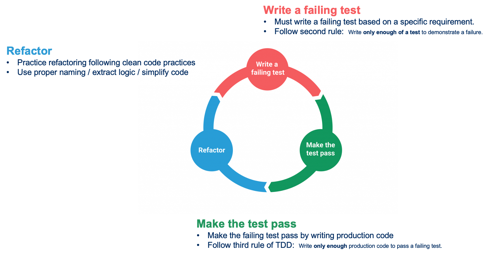
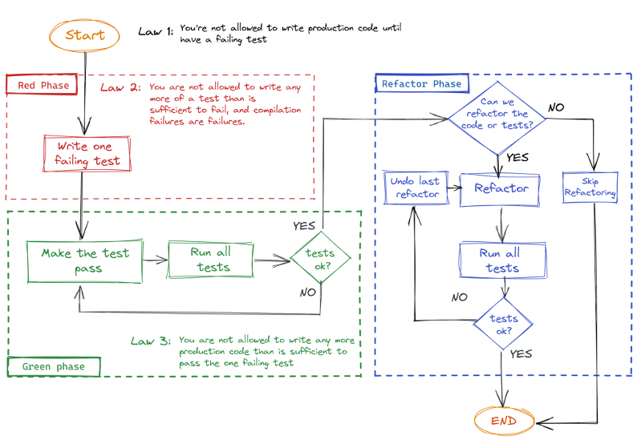

# What is TDD, and what TDD Guardian enforces

> "Test-Driven Development is a way of managing fear during programming." Kent Beck

Test-Driven Development comes from Extreme Programming (XP), where Kent Beck developed it on the C3
project. It rests on a few beliefs about code:

- **Simplicity**: maximise the work *not* done.
- **Obviousness and clarity** matter more than cleverness.
- **Uncluttered code** is key to success.

## TDD is not about testing

The tests are a safety net, not the goal. TDD is a way to **design and structure code** and to
**refactor safely**.

- **A bias towards simplicity.** You build the simplest thing that works and nothing more (YAGNI).
  Simplicity can be measured: lines of code per feature, cyclomatic complexity, side effects,
  runtime or memory needs. TDD does not automatically shorten development or reduce line or defect
  counts.
- **Confidence.** Each new test exercises the system in a new way. The suite guards against
  regressions and gives fast feedback on the state of the system.

  
- **A scientific approach.** Each test is a hypothesis, running it is the experiment. You observe
  the outcome and iterate.

## Red, Green, Refactor

- **Red**: write a failing test and run it to see it fail. A compilation failure is a failure.
- **Green**: write just enough production code to make it pass. Shortcuts are fine: hardcoding,
  duplication. This step should be fast.
- **Refactor**: remove code smells, such as duplication, hardcoded values or misused idioms. If a
  test breaks, get back to green first, and don't fall for sunk-cost thinking.

### The three rules (Uncle Bob)

1. Write production code only to make a failing unit test pass.
2. Write no more of a unit test than is enough to fail; compilation failures count.
3. Write no more production code than is enough to pass the one failing test.

## Canon TDD

In [Canon TDD](https://newsletter.kentbeck.com/p/canon-tdd), Kent Beck restates the workflow to
correct common misunderstandings of it:

1. **Test list.** List the behaviours to cover, including what existing behaviour must not break.
2. **Write a test.** Turn **exactly one** item into a concrete, runnable test: setup, invocation,
   assertions.
3. **Make it pass.** Change the code until this test and all the previous ones pass. A newly
   discovered case goes on the list.
4. **Optionally refactor.** Make the implementation design decisions now that the test passes.
5. **Repeat** until the list is empty.

> "Make it run, *then* make it right."

Canon TDD separates two kinds of design. **Interface design**, how the behaviour is invoked, is
mostly decided in step 2. **Implementation design**, how the system delivers it, is decided in
step 4. The order of the tests matters: it shapes both the process and the final code. Picking the
next test is a skill.

> "Keep testing & coding until your fear for the behavior of the code has been transmuted into boredom."

## From Canon TDD to TDD Guardian

Each mistake Kent Beck lists maps to a phase of TDD Guardian and a check it enforces:

| Canon step | Mistake (Kent Beck) | Phase | What TDD Guardian does |
| --- | --- | --- | --- |
| 1. Test list | skipping it and going straight to code | LIST | every write except `.tdd/test-list.md` is blocked until a human runs `/tdd:approve` |
| 1. Test list | mixing in implementation decisions | LIST | one item = one example, `input → outcome`, no design |
| 2. Write a test | turning every item into a test before making any pass | RED | a second new test is blocked: one test at a time |
| 2. Write a test | a test with no assertion, for coverage | RED, REFACTOR | the test must fail to leave RED; the assertion count cannot drop |
| 3. Make it pass | deleting assertions, editing the test until it passes | GREEN | tests, Fakes and test support are read-only; the test-code hash is checked when leaving GREEN |
| 3. Make it pass | mixing refactoring into make-it-pass | GREEN → REFACTOR | refactoring has its own phase, entered only with a green suite |
| 4. Refactor | abstracting too soon: "duplication is a hint, not a command" | REFACTOR | the skill asks for triangulation: fake it first, generalise when a second example forces it |
| 5. Repeat | | REFACTOR → RED | `tdd.js next` goes back to RED while items remain, and to OFF when the list is empty. By default the agent pauses after each item: the human reviews it and starts the next one with `/tdd:next` |

A few things TDD Guardian adds on top of the canon, all in [the skill](../skills/tdd/SKILL.md):

- **The list opens with the non-passing case.** It decides the interface first: a refusal is a
  value (`Optional.empty()`, `Refused`), not an exception. See
  [avoid exceptions](https://xtrem-tdd.netlify.app/flavours/design/avoid-exceptions/).
- **Each example forces one more piece of code**, so the list grows the thinnest complete
  implementation.
- **The human stays in charge of every step.** After each item, the agent stops and shows its work;
  only the human starts the next item (`reviewBetweenItems`, on by default).
- **Refactoring is not optional here.** Every cycle passes through REFACTOR, even when it changes
  nothing, so the review checklist is always run.
- **Two modes**: inside-out, from the core rules outwards, and outside-in, the double loop with Fakes.

## Xtrem TDD

A craft mentor is available online: [xtrem-tdd.netlify.app](https://xtrem-tdd.netlify.app/).

## Further reading

- [Xtrem TDD money kata, concepts](https://github.com/les-tontons-crafters/xtrem-tdd-money-kata/blob/main/docs/concepts.md), the source of the concepts and diagrams on this page
- [Canon TDD](https://newsletter.kentbeck.com/p/canon-tdd), Kent Beck
- [TDD Manifesto, getting started](https://tddmanifesto.com/getting-started/)
